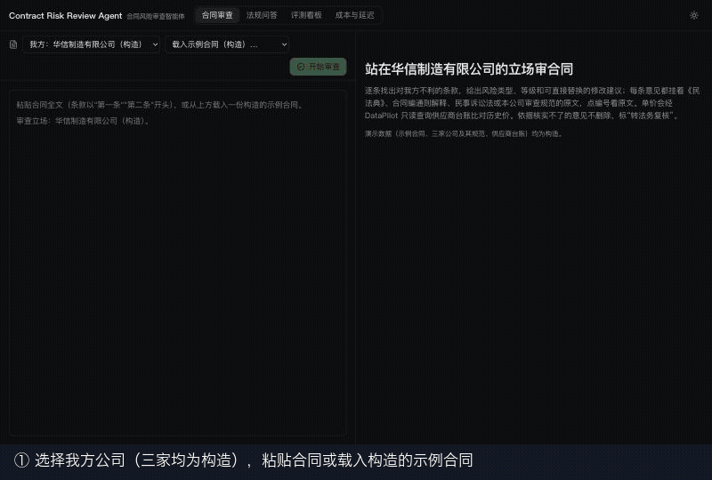

# Contract Risk Review Agent（合同风险审查智能体）

**逐条溯源 + 幻觉治理 + 转人工兜底的合同风险审查 Agent。**

提交一份商业合同，agent 站在我方（租户公司）的立场逐条找出不利条款，给出风险类型、风险等级和可以直接替换的修改建议；每条意见都挂着《民法典》、合同编通则解释、《民事诉讼法》、官方合同示范文本或本公司审查规范的**原文**，点编号就能看到高亮。单价会经 [DataPilot](../datapilot) 的只读 MCP 查询供应商台账，比对历史成交价。看不出我方是甲方还是乙方时先反问；依据核实不了的意见**不删除，标"转法务复核"**。



（39 秒，9 个关键画面；同内容 MP4：[docs/demo/contract-review-demo.mp4](docs/demo/contract-review-demo.mp4)。画面均为真实运行截图。）

> 演示数据（示例合同、三家公司及其审查规范、供应商台账）**全部是构造的**，见 [evals/README.md](evals/README.md)。项目由高校规章问答改造而来，场景变更理由见 [ADR 007](docs/adr/007-场景变更为合同风险审查.md)。

## 结果（Haiku 5.5，48 份构造合同）

| 指标 | 单 Agent（全部 / 留出集 28 份） | 多 Agent，默认（全部 / 留出集） |
|---|---|---|
| 风险检出率（召回，73 处） | 100% / 100% | 100% / 100% |
| 风险类型判对率 | 97.3% / 96.4% | 100% / 100% |
| 依据引用准确率（引用落在该风险的合法依据条文） | 97.3% / 96.4% | 100% / 100% |
| 意见精确率（高/中等级） | 76.1% / 82.4% | 82.3% / 84.6% |
| 干净合同误报（高/中，12 份） | 66.7% | 41.7% |
| 当事人空白时反问 / 多余反问 | 100% / 0% | 100% / 0% |
| 对我方有利的条款被误报 | 0% | 0% |
| 单份合同花费 P50 | $0.0038 | $0.0062 |

单 Agent 列为 `runs/review-full-20261023-201800`，多 Agent 列为 `runs/review-multi-full-20261024-103053`（第二次多 Agent 全量与单 Agent 第二次全量的对比见 ADR 012）。

- 20 份小样参与了调试（问题日志 P19、P20），所以另报未参与调试的 28 份留出集。精确率是全分支审查订正金标准后、在同一批输出上重算的值（订正前 72.6% / 81.1%，问题日志 P21）。
- 检出率触顶，说明植入的风险写得较显眼；这套数据真正拉开差距的是误报：12 份干净合同里 8 份被报出高/中等级意见。另外真风险里有近一半被模型自己标了转人工，偏保守。
- 依据校验（Sonnet 5.5 逐条评判 122 条意见）：理由里有无依据说法的意见 18.9%，其中**没被标转人工的从 6.6% 降到 0.8%**，误拦 2.0%；修改建议均分 3.86/5，≥4 分 77%。见 [ADR 008](docs/adr/008-合同审查的输出结构与依据校验.md)。
- 多轮追问：带上一轮审查历史时，"你列的第 k 条意见怎么改"答对 8/8（不带历史 0/8）；"换成乙方视角再看一遍"6/6 正确切换身份。
- 长对话上下文压缩（[ADR 011](docs/adr/011-长对话上下文压缩.md)）：12 组 × 8 轮、后面回指最早审查和中途决定。结构化摘要压缩与全量历史正确率持平（98.8%，回指早期轮次 95.8%），只留最近 2 轮掉到 75.0%（回指题 12.5%）；压缩后历史缩短 32%、后两轮输入 token 降 17%，但 8 轮内总花费只低 1%（每轮的大头是合同和检索结果），所以产品只在超过 8000 字时才压缩。
- 国产模型对比（[ADR 010](docs/adr/010-国产模型对比-DeepSeek.md)）：DeepSeek 检出、类型、依据与 Haiku 持平，精确率低约 6 个点、临界条款转人工 33% vs 83%，单份花费约 2.4 倍、模型耗时约 1.6 倍；默认仍用 Haiku，DeepSeek 作为私有化备选（`--model deepseek-flash`）。
- 同一份代码 Haiku 跑两次，干净合同误报（高/中）分别是 66.7% 和 83.3%——只有 12 份干净合同，这个指标波动大，读数时要注意。
- 合同场景累计 API 花费约 $10.37（含 v2 难评测集 $2.89）。全部数字、运行 ID 和测量条件见 [docs/numbers.md](docs/numbers.md)。

## 难评测集 v2（60 份长合同，75 处风险分 5 类，[ADR 013](docs/adr/013-难评测集v2.md)）

v1 上检出率触顶，于是做了更难的 v2：

- **合同**：每份 25–30 条。
- **风险**：藏在发票、变更等不相关条款里；换说法；要两条合起来看；数值刚越过规范红线。
- **干净合同**：放了刚好合规的数值、合法免责、对我方有利的条款作干扰项。
- **质检**：标准答案经独立代理质检，抽查清单经人工审核。

| 指标（各跑两次） | 单 Agent | 多 Agent（ADR 012 原版） | 多 Agent 改进后（默认） |
|---|---|---|---|
| 检出率（75 处） | 96.0% / 97.3% | 89.3% / 88.0% | **100% / 100%** |
| 跨条款组合 / 临界值 检出 | 83–92% / 93–100% | 66.7% / 73.3% | 100% / 100% |
| 精确率（高/中） | 61.6% / 61.0% | 68.1% / 68.6% | 65.7% / 62.6% |
| 干净合同误报（高/中，30 份） | 90.0% / 70.0% | 53.3% / 53.3% | 76.7% / 83.3% |
| 单份花费 P50 | $0.0045 | $0.0066 | $0.0115–0.0118 |

- **原版多 Agent 的盲区**：
  - 主审"按标题分工"，从不分派定义条款；
  - 定金和违约金分到了不同组；
  - 专职组不拿数值对照规范红线。
- **改进轮**：定义条款发给各组，漏分的条款按关键词兜底，专职组逐项对照红线。改进后两次都 75/75 检出，代价是误报回升、花费约 1.75 倍。合同审查里漏报比误报贵，所以默认用改进后的版本。
- **标准答案修正**：跑完后发现，数据集自己的基础定义等文本会引出合理意见，于是修正了一次标准答案（合同正文不变，前后两套数字都登记，问题日志 P25）。

## 它怎么工作

```
合同全文 ──► 主审（立场 + 分派） ──► 三个专职审查员并行（同下面的工具，各自只看分到的条款） ──► 汇总去重
              （单 Agent 模式：一个审查 agent 直接审全文）
审查 agent（Haiku 5.5，手写工具循环，最多 8 轮）
              ├─ search_docs   混合检索：BM25 + bge-m3 向量 → RRF → bge-reranker 重排
              │                 范围 = 通用法规与示范文本 + 本租户规范（租户由会话注入，模型改不了）
              ├─ run_sql       DataPilot 只读 MCP 查供应商台账（同名 CTE 遮蔽，只看得到本租户的行）
              ├─ ask_clarification   看不出我方是甲方还是乙方时反问
              └─ submit_review       逐条意见：条款、摘录、类型、等级、理由、修改建议、依据编号、是否转人工
        ──► 依据校验：规则层（点名的条文是否真被检索到）+ Haiku 逐条核对（依据不足 → 转人工，不删除）
        ──► Web：合同高亮 · 意见卡片 · 点编号看法条原文 · 多轮追问（"你列的第 2 条怎么改""换成乙方视角"）
```

- **多 Agent（首轮审查默认）**：主审判断我方立场、把条款分派给三个专职审查员（价款与履约 / 责任与违约 / 权利与争议），三者并行审查，主审汇总去重后统一做依据校验。v1 上和单 Agent 各跑两次：干净合同上的误报意见从 13–14 条降到 4–6 条，检出不变（[ADR 012](docs/adr/012-多Agent审查.md)）。v2 难评测集暴露出按标题分工的盲区，现在定义条款发给各组、漏分条款按关键词兜底、专职组逐项对照规范红线（[ADR 013](docs/adr/013-难评测集v2.md)）。追问仍由单 Agent 带着历史回答。
- 单 Agent 一次审查通常 2 轮模型调用：第一轮并发发起 5–7 个检索和查表，第二轮提交全部意见。
- 每一步都写 trace（输入输出、token、花费、耗时），Web 端可以逐步回放。
- 向量后端可切换到 Milvus Lite（结果与 numpy 完全一致；这个规模下 numpy 更快，默认不切），见 [ADR 009](docs/adr/009-Milvus-Lite向量后端.md)。

## 运行

```bash
uv sync
```

```bash
uv run cra ingest
```

```bash
uv run cra index
```

```bash
uv run cra serve
```

- `ingest` 按 [data/sources.toml](data/sources.toml) 下载法规与 7 份示范文本、解析入库，并构建供应商台账库；`index` 首次会下载 bge-m3 和 bge-reranker-v2-m3（各约 2.3GB）。
- `serve` 在 http://127.0.0.1:8000 打开 Web 界面（只监听本机），需要 `ANTHROPIC_API_KEY`（环境变量或仓库根目录 `.env`）。
- 示范文本来自市场监管总局合同示范文本库，网站只写了"版权所有"，所以原文只在本地使用、不进 git；仓库里只有文本 id 和下载脚本。

评测命令（会调用 Claude API，均有预算上限参数 `--max-cost`）：

```bash
uv run cra eval-review --sample 20
```

```bash
uv run cra review-d4 <eval-review 运行目录名>
```

```bash
uv run cra eval-review-dialog <eval-review 运行目录名>
```

```bash
uv run cra eval-contract-retrieval --backend milvus
```

可选：`uv sync --extra milvus` 安装 Milvus Lite 后端。

## 评测集

48 份构造合同，覆盖 7 类合同（工业品买卖、农产品买卖、加工承揽、仓储委托、数据委托处理、数据产品开发、数据供应），条款顺序参照官方示范文本、正文全部自写：

- 36 份植入 1–3 处风险，11 类风险每类 6–7 处；12 份干净合同（其中 6 份含"对我方有利的单方条款"，测视角）；
- 4 份当事人名称空白（测反问），6 处临界条款（测转人工）；
- 每处风险都标了合法依据集合（法条 + 公司规范条号），依据准确率按集合自动判分。

生成与校验：`uv run python scripts/make_contracts.py`，`uv run pytest tests/test_contract_evalset.py`。

## 目录

```
src/contract_review/
  review_agent.py     合同审查 agent：工具定义、结构化意见、追问与历史
  review_verify.py    依据校验：点名条文核对 + Haiku 逐条核对 + 转人工策略
  eval_review.py      审查评测：检出、类型、依据、误报、视角、转人工、反问
  eval_review_d4.py   依据校验评测（Sonnet 评判幻觉与修改建议质量）
  eval_review_dialog.py  多轮追问评测
  contract_evalset.py 评测集加载与分层小样
  agent.py            通用工具循环与 trace（审查和法规问答共用）
  tools.py            检索与查表工具、租户隔离（scope_sql）
  retrieve.py / bm25.py / embed.py / rerank.py / vector.py / milvus_index.py  检索
  datapilot_client.py DataPilot MCP 客户端（含本地只读降级）
  ledger_db.py        构造的供应商台账库
  html_parse.py / pdf_parse.py / structure.py / headings.py  解析：编、分编、章、节、条
  api.py              FastAPI：审查与追问 SSE、原文与高亮、评测运行回放
scripts/              构造数据生成（台账、合同）、分析与基准
web/                  Next.js 15 前端（合同审查、法规问答、评测看板、成本面板）
docs/                 ADR、问题日志、数字登记表、调研
evals/                构造评测合同
```

## 方法验证：高校规章问答（ADR 007 之前）

项目最初做的是高校规章问答，检索（Recall@5 97.9%）、agent（引用命中 96.3%）、生成后校验（幻觉率 31.9% → 15.6%）、多轮记忆等方法都在那个场景里验证过，数字保留在 [docs/numbers.md](docs/numbers.md) 和 ADR 002–005，**不当作合同场景的效果**。

## 开发

```bash
uv run pytest -q
```

```bash
uv run ruff check .
```

## 诚实边界

- 评测数据全部是构造的，存在"自己出题自己考"的风险；缓解办法是每类风险多种写法、agent 看不到植入规则、保留干净合同和视角干扰条款、另报留出集。
- 不构成法律意见；拿不准的条款由法务人工复核。
- 只为本机演示设计：服务只监听 127.0.0.1，没有登录与权限体系（会话 id 由服务端随机签发，但不绑定用户），不能直接对外部署。
- 法规文本以下载日期为准（《民事诉讼法》2023 年修正版取自上海市发改委网站转载的全文，原定的最高院公报页下载失败）。
