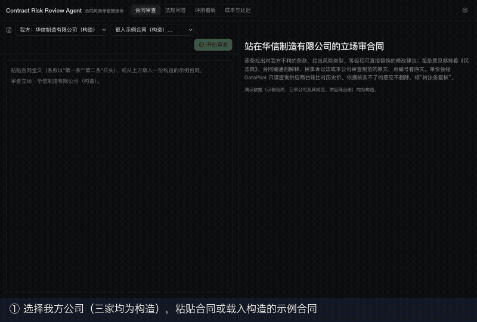

# Contract Risk Review Agent

合同风险审查。提交一份商业合同，系统站在我方立场逐条找出不利条款，给出风险类型、等级和可以直接替换的修改建议。每条意见都附上依据原文，来源包括《民法典》、合同编通则解释、《民事诉讼法》、官方合同示范文本和本公司的审查规范，点编号就能看到高亮的条文。

- 单价会通过 [DataPilot](https://github.com/kennywu411-dev/datapilot) 的只读 MCP 查供应商台账，和历史成交价比较。
- 看不出我方是甲方还是乙方时，先反问。
- 依据核实不了的意见不删除，标为"转法务复核"。



演示里的合同、三家公司的审查规范和供应商台账都是构造的，说明见 [evals/README.md](evals/README.md)。

## 结果

48 份构造合同，模型 Haiku 5.5。另报 28 份没有参与调试的留出集。

| 指标 | 单 Agent（全部 / 留出集） | 多 Agent，默认（全部 / 留出集） |
|---|---|---|
| 风险检出率（73 处） | 100% / 100% | 100% / 100% |
| 风险类型判对 | 97.3% / 96.4% | 100% / 100% |
| 依据引用准确率 | 97.3% / 96.4% | 100% / 100% |
| 意见精确率（高/中等级） | 76.1% / 82.4% | 82.3% / 84.6% |
| 干净合同误报（12 份） | 66.7% | 41.7% |
| 当事人空白时反问 / 多余反问 | 100% / 0% | 100% / 0% |
| 对我方有利的条款被误报 | 0% | 0% |
| 单份花费 P50 | $0.0038 | $0.0062 |

几点说明：

- 检出率已经到顶，说明 v1 里植入的风险偏显眼，真正拉开差距的是误报。所以又做了更难的 v2（见下一节）。
- 只有 12 份干净合同，误报率波动很大：同一份代码跑两次，单 Agent 是 66.7% 和 83.3%。
- 依据校验：用 Sonnet 逐条评判 122 条意见，理由里有无依据说法、却没有标转人工的意见从 6.6% 降到 0.8%，误拦 2.0%（[ADR 008](docs/adr/008-合同审查的输出结构与依据校验.md)）。
- 多轮追问：带上一轮审查历史时，"你列的第 k 条怎么改"答对 8/8，不带时 0/8。"换成乙方视角再看"6/6 切换正确。
- 长对话压缩：12 组 8 轮对话，结构化摘要和保留全部历史的正确率一样（98.8%），只留最近 2 轮掉到 75.0%。压缩后历史短了 32%，但总花费只降 1%，因为每轮的大头是合同全文和检索结果（[ADR 011](docs/adr/011-长对话上下文压缩.md)）。
- 和 DeepSeek 对比：检出、类型、依据持平，精确率低约 6 个点，单份花费约 2.4 倍。默认用 Haiku，DeepSeek 作为私有化部署的备选（[ADR 010](docs/adr/010-国产模型对比-DeepSeek.md)）。

全部数字、运行 ID 和测量条件见 [docs/numbers.md](docs/numbers.md)。

## 难评测集 v2

60 份长合同（每份 25–30 条），75 处风险分 5 类：藏在不相关的条款里、换一种说法、要两条合起来看、数值刚好越过规范红线，以及普通风险。30 份干净合同里放了刚好合规的数值、合法的免责和对我方有利的条款作为干扰（[ADR 013](docs/adr/013-难评测集v2.md)）。

| 指标（各跑两次） | 单 Agent | 多 Agent 初版 | 多 Agent 改进后（默认） |
|---|---|---|---|
| 检出率（75 处） | 96.0% / 97.3% | 89.3% / 88.0% | 100% / 100% |
| 跨条款组合 / 临界值 | 83–92% / 93–100% | 66.7% / 73.3% | 100% / 100% |
| 精确率（高/中） | 61.6% / 61.0% | 68.1% / 68.6% | 65.7% / 62.6% |
| 干净合同误报（30 份） | 90.0% / 70.0% | 53.3% / 53.3% | 76.7% / 83.3% |
| 单份花费 P50 | $0.0045 | $0.0066 | $0.0115–0.0118 |

初版多 Agent 按标题分工，定义条款没人审，定金和违约金被分到不同组，专职组也不拿数值去对照规范红线。改进后定义条款发给每个组，漏分的条款按关键词兜底，专职组逐项对照红线，两次都检出 75/75，代价是误报回升、花费约 1.75 倍。合同审查里漏报比误报代价大，所以默认用改进后的版本。

## 工作方式

```
合同全文 → 主审（判断立场、分派条款）→ 三个专职审查员并行 → 汇总去重
          （单 Agent 模式：一个审查 agent 直接审全文）

审查 agent（Haiku 5.5，工具循环最多 8 轮）
  search_docs         BM25 + bge-m3 向量 → RRF 融合 → bge-reranker 重排
                      范围：通用法规和示范文本 + 本租户规范，租户由会话决定，模型改不了
  run_sql             通过 DataPilot 只读 MCP 查台账，用同名 CTE 遮蔽，只能看到本租户的行
  ask_clarification   看不出我方是甲方还是乙方时反问
  submit_review       提交意见：条款、摘录、类型、等级、理由、修改建议、依据编号、是否转人工

依据校验：先核对点名的条文是否真的被检索到，再用 Haiku 逐条核对，依据不足就转人工
Web：合同高亮、意见卡片、点编号看条文原文、多轮追问
```

- 一次审查通常两轮模型调用：第一轮并发发起 5–7 次检索和查表，第二轮提交全部意见。
- 每一步都记录输入输出、token、花费和耗时，Web 端可以逐步回放。
- 向量检索可以切换到 Milvus Lite，结果和 numpy 一致，但在这个规模下 numpy 更快，所以默认不切（[ADR 009](docs/adr/009-Milvus-Lite向量后端.md)）。

## 运行

需要 Python 3.12、[uv](https://docs.astral.sh/uv/)、Node 20+ 和 npm。

```bash
uv sync                                               # 约 1GB（torch、docling）
uv run cra ingest                                     # 下载法规和 7 份示范文本、解析入库，生成供应商台账库
npm --prefix web install && npm --prefix web run build   # 构建前端到 web/out
uv run cra serve                                      # http://127.0.0.1:8000，只监听本机，托管 web/out
```

需要 `ANTHROPIC_API_KEY`，写在环境变量或根目录 `.env` 里：

```
ANTHROPIC_API_KEY=sk-ant-...
```

- 第一次审查请求会下载 bge-m3 和 bge-reranker-v2-m3（共约 2.3GB）并建向量缓存，要等几分钟；想提前做好，运行 `uv run cra index`（可选）。
- 没有 DataPilot 时查台账自动用本地库；装了 DataPilot 的话用 `DATAPILOT_DIR` 环境变量指向它的目录，`cra link-datapilot` 会把台账库链接进去。
- 示范文本来自市场监管总局合同示范文本库，网站标注了版权，所以原文只在本地使用、不进仓库，仓库里只有文本 id 和下载脚本。

评测（会调用 API，都有 `--max-cost` 预算上限）：

```bash
uv run cra eval-review --sample 20
uv run cra review-d4 <运行目录名>
uv run cra eval-review-dialog <运行目录名>
uv run cra eval-contract-retrieval --backend milvus   # 需要 uv sync --extra milvus
```

测试：`uv run pytest -q`。没有运行 `cra ingest` 时，依赖法规语料的几个测试会自动跳过。

## 评测集

48 份构造合同，覆盖 7 类合同：工业品买卖、农产品买卖、加工承揽、仓储委托、数据委托处理、数据产品开发、数据供应。条款顺序参照官方示范文本，正文是自己写的。

- 36 份植入 1–3 处风险，11 类风险每类 6–7 处；12 份干净合同，其中 6 份含对我方有利的单方条款，用来测立场判断。
- 4 份当事人名称空白，用来测反问；6 处临界条款，用来测转人工。
- 每处风险都标了合法依据集合（法条和公司规范条号），依据准确率按集合自动判分。

生成：`uv run python scripts/make_contracts.py`；校验：`uv run pytest tests/test_contract_evalset.py`。

## 目录

```
src/contract_review/
  review_agent.py       审查 agent：工具定义、结构化意见、追问与历史
  multi_agent.py        主审分派、专职审查员并行、汇总去重
  review_verify.py      依据校验
  review_memory.py      长对话压缩
  eval_review*.py       审查、依据校验、多轮追问的评测
  agent.py              通用工具循环和 trace
  tools.py              检索与查表工具、租户隔离
  retrieve.py bm25.py embed.py rerank.py vector.py milvus_index.py   检索
  datapilot_client.py   DataPilot MCP 客户端
  html_parse.py pdf_parse.py structure.py headings.py                解析到"编、章、节、条"
  api.py                FastAPI：审查与追问（SSE）、原文高亮、评测回放
scripts/                构造数据生成、分析脚本
web/                    Next.js 前端：合同审查、法规问答、评测看板、成本面板
docs/                   ADR、问题日志、数字登记、调研
evals/                  评测合同
```

## 早期场景

项目一开始做的是高校规章问答，检索（Recall@5 97.9%）、agent（引用命中 96.3%）、生成后校验（幻觉率 31.9% → 15.6%）和多轮记忆都在那个场景里验证过。后来考虑到合同审查更贴近企业的实际需求，换了场景，原因见 [ADR 007](docs/adr/007-场景变更为合同风险审查.md)。早期的数字保留在 [docs/numbers.md](docs/numbers.md) 和 ADR 002–005，不算作合同场景的效果。

## 局限

- 评测数据是自己构造的，有"自己出题自己考"的风险。缓解办法：每类风险用多种写法，agent 看不到植入规则，加入干净合同和干扰条款，另报留出集。
- 不构成法律意见，拿不准的条款由法务复核。
- 只为本机演示设计：服务只监听 127.0.0.1，没有登录和权限体系，不能直接对外部署。
- 法规文本以下载时的版本为准。《民事诉讼法》2023 年修正版取自上海市发改委网站转载的全文。

## 许可

代码使用 MIT 许可。法律法规文本不受著作权保护；合同示范文本不随仓库分发。
